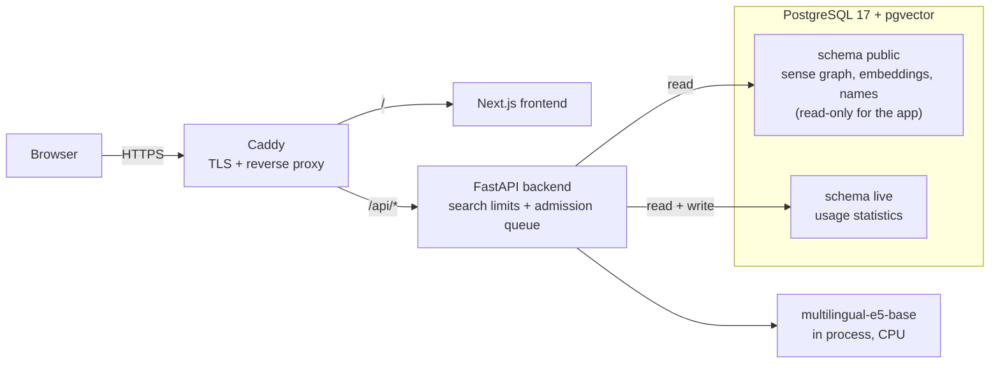
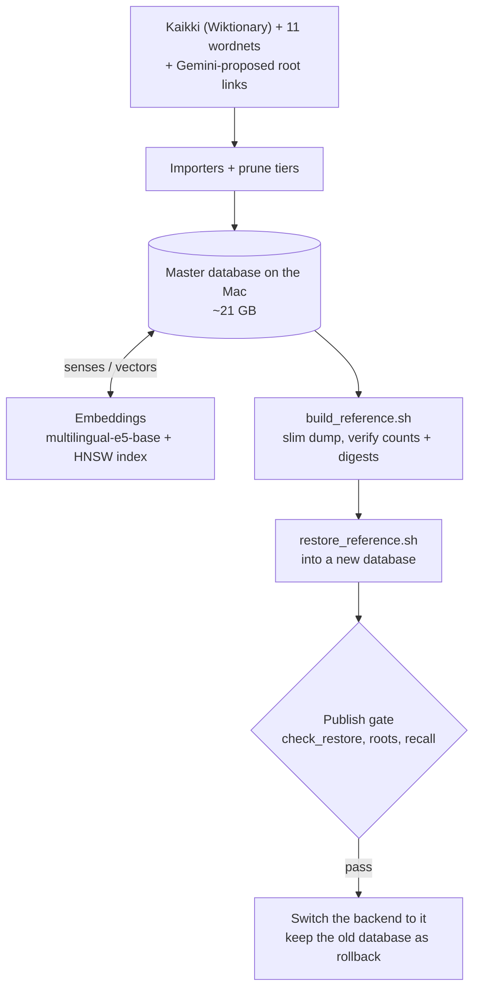

# NameLeaf

**Find names by meaning, across 21 languages.**

You type a meaning, such as *light*, *freedom* or *brave*, and pick the sense you mean. NameLeaf then walks a multilingual word graph to find words and attested names that carry that meaning in 21 languages, from Arabic and Latin to Japanese and Russian. Results are grouped by how far they are from the meaning you asked for. It is for anyone choosing a name with a meaning behind it: a baby, a story character, a game character.

Launching soon at https://nameleaf.app

[](https://github.com/ArmaghanAlvi/nameleaf/actions/workflows/test.yml)

## What it does

- **Search by meaning, not spelling.** A word you type opens a list of its senses, so *light* (not heavy) and *light* (illumination) give different results.
- **One result tree per language.** For each of the 21 languages, the backend finds the equivalent starting word, then expands from it up to 3 steps deep and 3 branches wide. Each starting word records which kind of evidence picked it.
- **Real names alongside words.** 106,398 attested given names and surnames from the imported languages appear as name cards. Each card can show gender, a romanization, an origin, and a dropdown of variants and cognates.
- **Honest waiting.** Large searches show "Large searches can take a few minutes." If the server is busy, the API answers with a plain message and a retry time instead of hanging.

## Example

An excerpt from a committed regression capture, [`parallel_api_reference.json`](backend/scripts/eval/publishC_baseline/post_cpu/parallel_api_reference.json). The search is the meaning *brave* at width 3, depth 2, with all 21 languages, run on CPU at 2 torch threads (production's setting) with query-time LLM calls off. The first three words of 12 of the 21 language trees are shown verbatim, in the order the API returned them.

| Language | Card type | Words in tree | First words |
|---|---|---|---|
| English | word | 10 | brave, bold, courageous |
| Arabic | word | 10 | مقدام, باسل, متهور |
| Japanese | word | 6 | 勇敢, 勇ましい, 健気 |
| Russian | word | 10 | смелый, смело, храбрость |
| Hindi | word | 8 | बहादुर, नायक, बीर |
| Hebrew | word | 2 | אמיץ, אומץ |
| German | word | 7 | tapfer, heldenhaft, mutig |
| Spanish | word | 5 | valiente, valeroso, impávido |
| Korean | word | 11 | 용감하다, 용맹, 명철하다 |
| Greek | word | 9 | θαρραλέος, γενναίος, ανδρειωμένος |
| Old English | word | 2 | beald, unforht |
| Old Norse | word | 1 | djarfr |
| (all languages) | established name | 41 | Baldhelm, Baldur, Baldwulf, Ceolbeald, Conrad, Conrado, Cuþbeald, Eadbeald |

The same search returned 148 word cards in total; 7 of them are also established names and show as merged cards. The capture records the first eight name cards but not their languages.

## How it works

1. **Data.** Kaikki's Wiktionary extracts and 11 wordnets are imported into one sense graph in PostgreSQL. On 2026-10-04 it held 2,262,079 senses, 6,366,733 sense relations, 699,460 translations and 1,549,089 sense embeddings.
2. **Query.** The senses you select become a query text, which is embedded with `intfloat/multilingual-e5-base`, running inside the backend process.
3. **Starting words.** For each language, root selection tries a fixed ladder of evidence: `corroborated → primary → ili → llm → pivoted_root → fallback`. The rungs are translation links, a shared interlingual index, an LLM-proposed link checked against the database, a pivot through Russian, and finally the nearest embedding. The rung used is returned with each tree.
4. **Expansion.** Each tree is walked breadth-first: up to `width` children per node, for up to `depth` levels, drawn from the sense graph and from vector nearest neighbours. The trees are then interleaved: all starting words first, then one word per language in turn.
5. **Names.** Established-name cards are attached to the finished result.

**Request path (production)**



**Data and publish path**



## Engineering decisions

**1. No hand-edited data, and regression gates that demand identical output.**
*Constraint:* one maintainer, about 2.3 million senses, and no time to review rows by hand. *Choice:* every data change is a script run from the master database. Changes to the search engine are checked by capture scripts in [`backend/scripts/eval/`](backend/scripts/eval/) that must reproduce committed reference output byte for byte. A fixed invariant (106,398 established names) also has to hold. *Tradeoff:* a known data error waits for a scripted fix instead of a quick manual edit. *Evidence:* gate output on the Mac's CPU is byte-identical to its GPU (MPS) output. The production image on Linux arm64 is byte-identical to the Mac on the same data. The rehearsed restore passed `check_restore` (31 tables, 3 content digests).

**2. One database for everything.**
*Choice:* the sense graph, 1,549,089 embeddings with their HNSW index, and live usage data all live in one PostgreSQL instance with pgvector. Publishing, backups and least-privilege roles each have one system to cover. *Tradeoff:* memory. The ~6 GB HNSW index shares the planned 12 GB server with everything else, and it is why the database container's limit is 8 GB (index plus `shared_buffers` exceeded 6 GB). *Evidence:* measured peaks during the rehearsed restore and searches. The database peaked at 5.97 GiB during the index build (at its then 6 GiB limit) and 4.82 GiB during searches, and the backend at 0.91 GiB. Those peaks leave headroom on 12 GB, so half-precision vectors were skipped; a load test on the server will confirm it under real traffic.

**3. CPU-only production, with limits chosen from a measured timing grid.**
*Constraint:* the target host has 2 ARM cores and no GPU. *Choice:* measure first. A timing grid covered every width × depth cell from 0×0 to 3×3 for *brave*, *light* and *storm*, with all 21 languages, on the Mac's CPU at 2 torch threads, which is a lower bound for the server. In the cells whose WARM median exceeded 10 s, SQL was 61.5–82.1% of WARM wall time and embedding was 5.5–8.4% of COLD wall time. Earlier CPU measurements had shown the same pattern, which is why planned embedding batching was dropped before the grid (it was also not bit-exact). The 3×3 COLD medians were 51.8 s (*brave*), 76.4 s (*light*) and 69.4 s (*storm*). Production allows every search up to 3×3. Searches with width × depth ≥ 4 count as large, and only one runs at a time. Two searches run at once, normal ones queue 4 deep for up to 30 s, and every search has a 300 s timeout. *Tradeoff:* large searches are slow, and some users get a "busy" answer. *Evidence:* separately, one 3×3 *light* search through the full production stack on the Mac (browser → Caddy → backend) returned in 45.3 s. [`test_search_admission.py`](backend/tests/test_search_admission.py) covers the queue and the large-search lane.

**4. Search results never read usage statistics.**
*Choice:* selection counts only order the sense dropdown. The results path does not read them, so the same request on the same data always gives the same answer. That keeps the gates meaningful and makes a result cache possible later. *Tradeoff:* popular meanings get no ranking boost in results. *Evidence:* [`backend/tests/test_results_never_read_statistics.py`](backend/tests/test_results_never_read_statistics.py) fails if a results module references the statistics tables. Production also writes no statistics at launch.

**5. Publish by restoring into a new database, gated on recall rather than identity.**
*Choice:* each publish restores a slimmed dump into a new database while the old one keeps serving, then switches the backend and keeps the old database for one cycle as the rollback. The restore took about 70 minutes on the Mac, which is publish time, not downtime. *Tradeoff:* a restore rebuilds the HNSW graph, and approximate nearest-neighbour search with a language filter misses some true matches. The rebuilt index misses slightly different ones, so filtered results shift on every publish, and byte identity with master is impossible. *Evidence:* exact (index-off) results were identical on master and the restored copy, and repeating the measurement on one index changed nothing. The gate is therefore: `check_restore` passes, the starting words for the probe meanings are byte-identical to master's capture taken just before the build, and recall against exact search drops by at most 0.02 at top-15 and top-150, and at most 0.07 at top-1. The gate script is [`recall_check.sh`](backend/scripts/publish/recall_check.sh).

**6. Data choices follow licenses.**
*Choice:* a Chinese given-names dataset (GPL-3 + CC BY-NC-SA, non-commercial only) was declined permanently, so Chinese names come from Kaikki alone. RuWordNet is excluded; its manifest records the license as "non-commercial, email-gated". Every live source has, or will get, a manifest in [`backend/data/source_manifests/`](backend/data/source_manifests/), and the public attribution page will be generated from those manifests. *Tradeoff:* thinner coverage for Chinese names and Russian senses. *Evidence:* the manifests listed under Data sources.

## Limitations

- **Coverage is uneven.** In the example above, Old Norse's tree has 1 word, against 10 for English and Arabic. Nearest-neighbour search also finds fewer true matches for small languages such as Old Norse and Swahili.
- **Definitions are mostly in English.** Most entries come from the English edition of Wiktionary, so an English word with several meanings can pull in a related word from the wrong meaning.
- **Origins are partial.** Name origins are resolved only for names labelled English. Origin labels for some names that are also ordinary words may be wrong; a fix is planned.
- **Some names have no meaning yet.** Korean given names ship without recorded meanings, and cards say "Meaning not recorded" where that is the case.
- **Weak starting words.** When no translation evidence exists, a language's starting word is picked by embedding similarity. These are the least reliable, and the API marks them.
- **Large searches are slow.** The 2-core server is estimated at 2–3× the Mac's time, so a 3×3 search may take a few minutes, and only one runs at a time.
- **Not built yet:** user accounts, and generated names (new names built from parts).

## Stack

| Layer | Technology |
|---|---|
| Backend | Python 3.14, FastAPI, SQLAlchemy 2, Alembic, pydantic-settings |
| Embeddings | sentence-transformers + PyTorch (CPU in production), `intfloat/multilingual-e5-base` at a pinned revision |
| Database | PostgreSQL 17 + pgvector 0.8.3 (HNSW) |
| Frontend | Next.js 16, React 19, Tailwind CSS 4, TypeScript |
| Serving | Caddy 2.11.4, Docker Compose, one uvicorn worker |
| CI | GitHub Actions: pytest, ESLint, Next.js build |
| Errors | Sentry SDK, off unless `SENTRY_DSN` is set |

## How it was built

I design the system and direct all the work. Planning happens in conversation with Claude. Implementation is split into small scoped sections, carried out either by myself or Claude Code after I approve its plans. I make every commit, run every operation on the master database, and read every gate result myself. The guardrails live in the repo: [`CLAUDE.md`](CLAUDE.md) sets the rules, and a hook in [`.claude/hooks/guard.py`](.claude/hooks/guard.py) blocks destructive database commands, reads of secret files and git writes. The hook is tested in [`backend/tests/test_claude_guard.py`](backend/tests/test_claude_guard.py).

## Why I built it

My original inspiration for this project came from a Creative Writing Workshop gen-ed course I took in my freshman year at UMD. In the stories we had to write, a common thing I heard from almost every writer was that character naming was a long, tedious process, which some people dreaded so much they chose not to name their characters at all. When I myself was naming characters,  I always felt that the names should be meaningful, and would spend long hours with google translate, ChatGPT, and Gemini, trying to find different translations of words that could be names, or names from various languages that might match the meaning I was looking for. It is a common strategy, after all, to name things after words that have meanings connected to what you want them to represent. My own name "Armaghan" is just the Persian word for "gift", for example. There are also various examples you can find in fiction, like "Aslan" from Narnia, "Lupin" from Harry Potter, "Shifu" from Kung Fu Panda, "Candide" from Candide,  "Simba" and "Mufasa" from the Lion King, "Frieren" from Beyond Journey's end, and the list just goes on and on.

There weren't any sites online that could help me with the wide language search I was looking for, so I decided to try to create an applictation to make this process faster. This is when I realized that when trying to give anything a meaningful name by using words that represent a meaning, whether it be for a child, to a pet, to a company, to a fictional character, the process I was trying to optimize could be applied. There were sites out there that allow you to search meanings and find names, but they weren't capable of searching in a way that let you explore how a concept manifests in different waysaround the world.

Hence my starting this project. I didn't at all expect it to end up as complex as it did.

## What I learned

- How full stack works -> I've never made a project of this scale before, so literally everthing was new territory
- Databasing -> Similarly, I've mostly just written programs that run tasks and operations, but this time, I needed to also manage and manipulate a large amount of data to get the results I wanted
- AI -> I've never really coded with extensive LLM assistence before, so this was a long process in getting more comfortable with trusting and understanding how to use (and how not to use) AI in the process
- Project design -> Since it started and ended with just me and a dream, I had to figure out how to actually go from constructing an idea in my head to actually manifesting it on my computer. There were so many details I overlooked in my original design, and honestly, its alost unrecognizable from the first skeleton I made.

## What I'd do differently

- I wouldn't have started the way I did, using regular ChatGPT chats to plan and execute my ideas. I had no idea how to effectively leverage AI to my advantage, and was honestly just floundering and hoping for the best. Now I have an actual workflow, and a method to getting things done.
- Don't trust or follow AI blindly. This is connected to the previous one. In the early stages, once I'd started using AI more, I got to a point multiple times where I was chasing a feature down a rabbit hole, only to stop after a few days, think about it, and realize that the reason it was so difficult was because the feature itself was flawed. 
- Plan a bit more extensively beforehand. Related to the previous one once again. There were so many times when I had to completely swtich tracks and redesign becuase the angle I was taking was turning out to just...not work at all. Thinking more carefully about how a feature would play out became immensly helpful in not chasing endless rabbit holes.

## Running locally

**What works on a fresh clone: the test suite.** Tests use an in-memory SQLite database, so no PostgreSQL is needed. The `DATABASE_URL` below is the same dummy value CI uses: it must exist for the settings to load, but nothing connects to it.

```bash
git clone https://github.com/ArmaghanAlvi/nameleaf.git
cd nameleaf
python3.14 -m venv backend/.venv
source backend/.venv/bin/activate
pip install -r backend/requirements-dev.txt
DATABASE_URL=postgresql+psycopg://ci:ci@localhost:5432/ci ROOT_LLM_QUERY_TIME=0 PREWARM_ON_STARTUP=0 python -m pytest
```

On Linux, install the pinned `torch` from PyTorch's CPU wheel index before the requirements, as [`.github/workflows/test.yml`](.github/workflows/test.yml) does.

The frontend lints and builds without the backend, as in CI:

```bash
cd frontend
npm ci
npm run lint
npm run build
```

**What doesn't work on a fresh clone: the full app.** Search needs the ~21 GB master database. It is built from Kaikki and wordnet downloads that are not in this repo, by the importers in `backend/app/importers/`.

## Project structure

```
.
├── backend/
│   ├── app/             FastAPI app: routes, search services, models, importers
│   ├── migrations/      Alembic migrations
│   ├── scripts/         eval/ (regression gates), publish/ (build, restore, gate), prune/, backfills
│   ├── tests/           pytest suite (in-memory SQLite)
│   ├── data/            source manifests, curated data
│   └── Dockerfile.prod  CPU-only production image with the model baked in
├── frontend/
│   ├── src/             Next.js App Router pages, components, API client
│   └── Dockerfile.prod
├── deploy/Caddyfile     reverse proxy and TLS
├── docker-compose.yml       local PostgreSQL + pgvector
├── docker-compose.prod.yml  production stack
├── .github/workflows/   CI
├── .claude/             Claude Code guard hook and settings
├── CLAUDE.md            project rules for Claude Code
└── LICENSE
```

## Data sources

The 13 live sources. Names, attributions and licenses are copied from each source's manifest. A full attribution page comes with the launch.

- **kaikki**: Kaikki.org (Wiktionary-derived, CC BY-SA 4.0 and GFDL)
- [Open English Wordnet 2025](backend/data/source_manifests/oewn-2025/source_manifest.json) (English). Open English Wordnet Community. Derived from Princeton WordNet and released under Creative Commons Attribution 4.0. License: CC-BY 4.0.
- [Japanese WordNet (Open Multilingual Wordnet v2.0)](backend/data/source_manifests/omw-ja/source_manifest.json) (Japanese). Japanese WordNet via Open Multilingual Wordnet. Bond, Baldwin et al. License: WordNet-style permissive with attribution.
- [Arabic WordNet v2 (Open Multilingual Wordnet v2.0)](backend/data/source_manifests/omw-arb/source_manifest.json) (Arabic). Arabic WordNet via Open Multilingual Wordnet. License: CC-BY-SA 3.0.
- [Arabic WordNet 4.0](backend/data/source_manifests/awn4/source_manifest.json) (Arabic). Arabic WordNet 4.0. AI-translated (Gemini + Claude) from Open English WordNet 2024. License: CC-BY 4.0.
- **llm-root**: machine-generated by Google Gemini from Wiktionary-derived text
- [Líonra Séimeantach na Gaeilge (LSG) — Irish WordNet](backend/data/source_manifests/lsg/source_manifest.json) (Irish). Líonra Séimeantach na Gaeilge (LSG), Kevin P. Scannell, 2006. License: CC-BY-SA 4.0.
- [Hebrew Wordnet (Open Multilingual Wordnet)](backend/data/source_manifests/omw-he/source_manifest.json) (Hebrew). Hebrew Wordnet via Open Multilingual Wordnet. Ordan and Wintner (2007). License: WordNet-style permissive with attribution.
- [OdeNet — Offenes Deutsches WordNet](backend/data/source_manifests/odenet/source_manifest.json) (German). OdeNet (Offenes Deutsches WordNet), Melanie Siegel and Francis Bond, GWC2021. License: CC-BY-SA 4.0.
- [plWordNet (Open Multilingual Wordnet)](backend/data/source_manifests/omw-pl/source_manifest.json) (Polish). plWordNet via Open Multilingual Wordnet. Piasecki, Szpakowicz, Broda (2009). License: WordNet-style permissive with attribution.
- [Spanish WordNet (Multilingual Central Repository, via OMW)](backend/data/source_manifests/omw-es/source_manifest.json) (Spanish). Multilingual Central Repository (Spanish), via Open Multilingual Wordnet. Gonzalez-Agirre, Laparra, Rigau (2012). License: CC-BY 3.0.
- [Chinese Open Wordnet (Open Multilingual Wordnet)](backend/data/source_manifests/omw-cmn/source_manifest.json) (Chinese). Chinese Open Wordnet (COW) via Open Multilingual Wordnet. Wang and Bond (2013). License: WordNet-style permissive with attribution.
- [Greek Wordnet (Open Multilingual Wordnet)](backend/data/source_manifests/omw-el/source_manifest.json) (Greek). Greek Wordnet via Open Multilingual Wordnet. Stamou, Nenadic, Christodoulakis (2004), Balkanet project. License: Apache License 2.0.

## Contact

contact@nameleaf.app. Feedback and bug reports are welcome as [GitHub Issues](https://github.com/ArmaghanAlvi/nameleaf/issues).

## License

Code: MIT ([LICENSE](LICENSE)). Data: under its own licenses (above).
